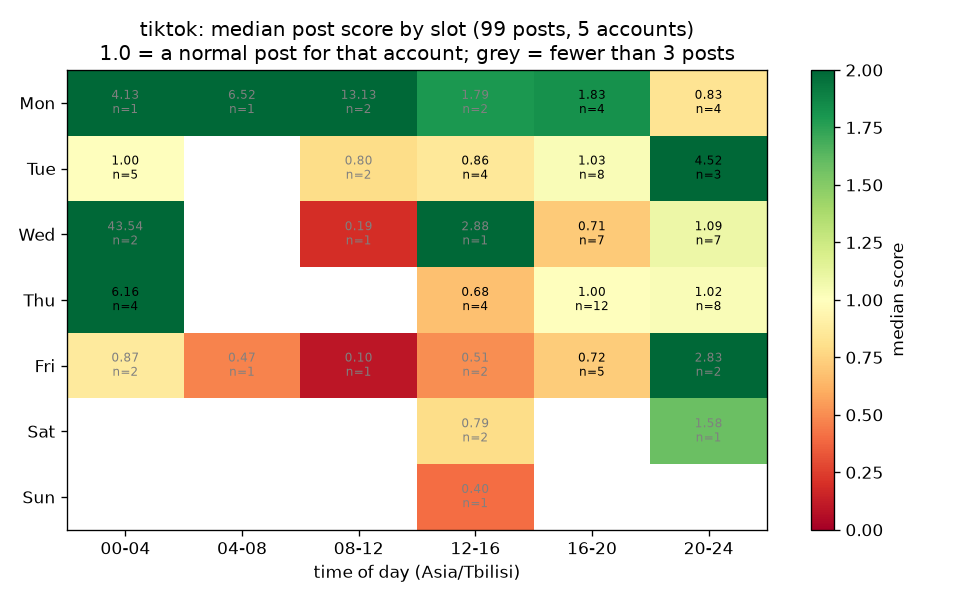
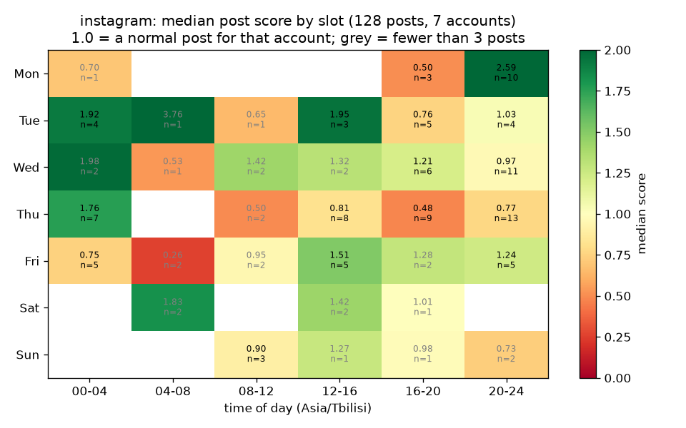
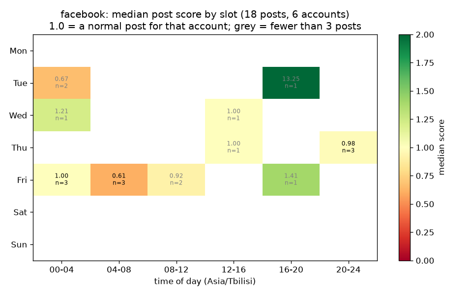

# Posting Time Check (2026-10-09)

Made by [Desearch](https://desearch.ai). Data fetched 2026-10-09 09:36 Asia/Tbilisi; slots shown in Asia/Tbilisi; count=30 per request, up to 2 page(s) per account (TikTok and Instagram); scored = posts from the last 90 days with a public like/reaction count.

Score = post engagement / median engagement of that account's returned posts (1.0 = a normal post for that account). Slots = weekday x 4-hour block. Only slots with at least 3 posts are ranked. This describes public engagement on the recent posts in this sample only. It says nothing about reach, and it is not a rule for other accounts or niches.

## tiktok

Sample: 99 posts from 5 accounts, posted 2026-07-16 to 2026-10-09 (UTC dates); 13 of 42 slots have 3+ posts.

| | slot | median score | posts | accounts |
|---|---|---|---|---|
| best | Thu 00-04 | 6.16 | 4 | 2 |
| best | Tue 20-24 | 4.52 | 3 | 3 |
| best | Mon 16-20 | 1.83 | 4 | 3 |
| worst | Thu 12-16 | 0.68 | 4 | 2 |
| worst | Wed 16-20 | 0.71 | 7 | 4 |
| worst | Fri 16-20 | 0.72 | 5 | 4 |

Read with care: median slot has 5 posts, so single posts move the result.

## instagram

Sample: 128 posts from 7 accounts, posted 2026-08-07 to 2026-10-09 (UTC dates); 16 of 42 slots have 3+ posts.

| | slot | median score | posts | accounts |
|---|---|---|---|---|
| best | Mon 20-24 | 2.59 | 10 | 3 |
| best | Tue 12-16 | 1.95 | 3 | 1 |
| best | Tue 00-04 | 1.92 | 4 | 3 |
| worst | Thu 16-20 | 0.48 | 9 | 4 |
| worst | Mon 16-20 | 0.50 | 3 | 3 |
| worst | Fri 00-04 | 0.75 | 5 | 3 |

Read with care: median slot has 5 posts, so single posts move the result.

## facebook

Sample: 18 posts from 6 accounts, posted 2026-09-21 to 2026-10-09 (UTC dates); 3 of 42 slots have 3+ posts.

| | slot | median score | posts | accounts |
|---|---|---|---|---|
| best | Fri 00-04 | 1.00 | 3 | 2 |
| worst | Fri 04-08 | 0.62 | 3 | 3 |

Read with care: median slot has 3 posts, so single posts move the result; best and worst slot differ by only 0.38.

## Accounts

| platform   | handle            | role   |   posts_returned |   scored |   newest_days |   oldest_days |   over_90_days |   median_engagement |
|:-----------|:------------------|:-------|-----------------:|---------:|--------------:|--------------:|---------------:|--------------------:|
| facebook   | Bybit             | peer   |                3 |        3 |           0.1 |           0.4 |              0 |                13   |
| facebook   | CryptoComOfficial | peer   |                3 |        3 |           6.9 |          13.7 |              0 |               234   |
| facebook   | binance           | peer   |                3 |        3 |           0.1 |           0.6 |              0 |               149   |
| facebook   | bitcoinist        | peer   |                3 |        0 |         398.5 |        1286.8 |              3 |               nan   |
| facebook   | coinbase          | peer   |                3 |        3 |           0.2 |           9.7 |              0 |                28   |
| facebook   | coindesk          | main   |                3 |        3 |          16.4 |          17.3 |              0 |                38   |
| facebook   | watcherguru       | peer   |                3 |        3 |           0.3 |           0.5 |              0 |               432   |
| instagram  | ambcrypto         | peer   |               12 |        6 |           3.6 |         906.7 |              6 |                 2   |
| instagram  | binance           | peer   |               24 |       23 |           0.6 |         119.9 |              1 |              1465   |
| instagram  | bybit_official    | peer   |               24 |       24 |           0.7 |           8.7 |              0 |                75.5 |
| instagram  | coinbase          | peer   |               24 |       23 |           0.2 |         210.5 |              1 |               773   |
| instagram  | coindesk          | main   |               24 |       24 |           0.2 |          20.4 |              0 |                37.5 |
| instagram  | cryptoslate       | peer   |               12 |        4 |           0.5 |         174.5 |              8 |                29.5 |
| instagram  | decryptmedia      | peer   |               24 |       24 |           0.3 |           1.4 |              0 |                 1   |
| tiktok     | beincrypto        | peer   |               19 |       19 |           0.5 |          10.7 |              0 |                 7   |
| tiktok     | binance           | peer   |               20 |       20 |           0.6 |          22.6 |              0 |              1573.5 |
| tiktok     | coinbase          | peer   |               20 |       20 |           7.6 |          84.6 |              0 |                58   |
| tiktok     | coinbureau        | peer   |               20 |       20 |           0   |           6.7 |              0 |                31   |
| tiktok     | coindesk          | main   |               20 |       20 |           0.2 |          17.4 |              0 |                80   |
| tiktok     | cryptonews        | peer   |                9 |        0 |         160.2 |         177.1 |              9 |               nan   |
| tiktok     | cryptoslate       | peer   |               10 |        0 |         474.1 |         943.1 |             10 |               nan   |
| tiktok     | decryptmedia      | peer   |               10 |        0 |         107.6 |         119.6 |             10 |               nan   |
| tiktok     | watcherguru       | peer   |               10 |        0 |         133   |         725.7 |             10 |               nan   |

## Cost

49 calls, 316 posts returned, 316 billed units, $0.6541 (sum of X-Desearch-Cost-Usd headers).
