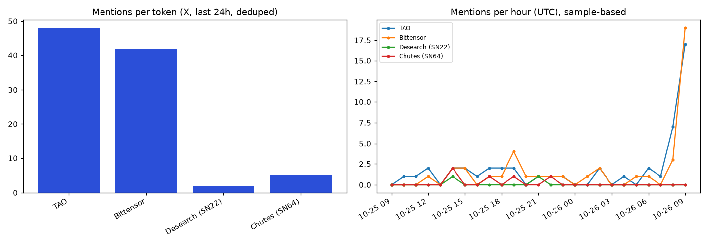

# Token Narrative Pulse, 2026-10-26

Made by Desearch ([desearch.ai](https://desearch.ai))

Account handles are replaced with neutral labels (Account 1, Account 2 and so on), and X links use the x.com/i/status form.

Window: 2026-10-25 09:48 to 2026-10-26 09:48 UTC. Sources: Desearch API (X search, AI Search on X, and web search limited to reddit.com).

## Mentions (X, deduplicated, inside the 24h window)

| Token | Mentions | Unique authors |
|---|---|---|
| TAO | 48 | 41 |
| Bittensor | 42 | 38 |
| Desearch (SN22) | 2 | 2 |
| Chutes (SN64) | 5 | 4 |

Posts returned: 94; unique: 78; inside window: 69; outside window (dropped): 9; posts missing an engagement field: 0.

These are counts inside a sample (Top + Latest, `--count` posts per query), not total X volume. Latest returns the newest posts, so the last hours look busier in the hourly chart.

## Top 5 posts by engagement

Engagement = likes + 2 x reposts + replies + quotes.

| # | Author | Likes | Reposts | Replies | Views | Posted (UTC) | Post |
|---|---|---|---|---|---|---|---|
| 1 | Account 1 | 193 | 9 | 18 | 14480 | 2026-10-25T19:23 | [Thinking out loud here.. I've always assumed a #Bittensor subnet would struggle to replicate what $TIG is buil](https://x.com/i/status/2114437675180577127) |
| 2 | Account 2 | 158 | 27 | 6 | 11028 | 2026-10-25T16:40 | [https://t.co/C6FU7YKPji](https://x.com/i/status/2114396664798597387) |
| 3 | Account 1 | 171 | 14 | 15 | 13236 | 2026-10-25T15:39 | [The problem with #Bittensor is.. If you spend even a week not keeping up with whats happening.. you end up so ](https://x.com/i/status/2114381417538810265) |
| 4 | Account 3 | 137 | 9 | 8 | 13957 | 2026-10-25T14:29 | [#TAO Telegramdan gelen istek analiz. Dostlar, $TAO listelendiği günden bu yana devam eden düşüş trendini geçti](https://x.com/i/status/2114363792679112801) |
| 5 | Account 4 | 98 | 9 | 6 | 9024 | 2026-10-25T21:28 | [AI agents have made it clear that SN51 lium is the market leader in cloud GPU rentals Nearly 70% of their cust](https://x.com/i/status/2114469266338832714) |

## Spam and duplicate check

- Identical-text groups (after stripping links/punctuation): 0
- Authors with 3+ posts in the sample: Account 5 (3)
- Template groups (2+ authors, same closing text): 0 groups, 0 posts
- Cashtag-stuffed posts (5+ cashtags): 4
- Zero-engagement posts from accounts under 50 followers: 2
- Posts flagged by any rule: 7 of 69

## Language mix

en: 60, qme: 3, tr: 2, vi: 2, und: 1, zxx: 1

## AI Search narrative (bull / bear / neutral)

### tools = twitter

**Bullish**  
- Taostats has improved significantly recently and is recommended as a comprehensive toolkit for Bittensor users [1](https://x.com/i/status/2114432343733887371).  
- Subnet 4 (Targon) is highlighted as one of the best setups in crypto currently, with confidential compute seen as a promising upcoming story after Liums GPU rental marketplace [10](https://x.com/i/status/2114440945206964669).  
- SN92 REAX is the most traded subnet with ~87k $TAO traded recently, showing strong activity and pool growth in several subnets [6](https://x.com/i/status/2114407807013245397).  

**Bearish**  
- Emission splits for some subnets have shifted, with validators and miners seeing reduced percentages in some cases, which could indicate changing incentives or challenges [3](https://x.com/i/status/2114644947022365128)[5](https://x.com/i/status/2114378285094146336).  
- SN28 shows a mixed week with pool $TAO still about 1k below a week ago despite some recent gains [7](https://x.com/i/status/2114526992334786905).  

**Neutral**  
- Bittensor ecosystem updates and insights are actively shared, with discussions on eTAO, Gamma, and permissionless lending ongoing in community spaces [2](https://x.com/i/status/2114592139674054794)[4](https://x.com/i/status/2114417947448115469).  
- Robotics subnet SN80 holds a moderate share of emissions and neurons, indicating steady but not dominant activity [9](https://x.com/i/status/2114436890732765376).  
- Commentary on AI decentralization in Bittensor is present but without clear bullish or bearish stance [8](https://x.com/i/status/2114410632116068525).  

No mentions of Desearch or Chutes SN64 in the last 24 hours [all].

Checks: 10 X posts returned, 0 older than 24h; 10 links cited in the summary, 0 not found among returned sources; bull/bear/neutral sections present: True.

## Reddit threads (web search, site:reddit.com)

Results returned: 20; kept from reddit.com or its subdomains: 20.

> Note: Web search results carry no post date, so confirm a thread's date before quoting it.

- [r/bittensor_ on Reddit: Bittensor $TAO has its first $100M subnet, just 9 weeks after dTAO](https://www.reddit.com/r/bittensor_/comments/1k464kv/bittensor_tao_has_its_first_100m_subnet_just_9/)
- [r/bittensor_ on Reddit: I’m still pretty new to the subnets …why is Chutes no longer givin](https://www.reddit.com/r/bittensor_/comments/1s782kw/im_still_pretty_new_to_the_subnets_why_is_chutes/)
- [Lost TAO while staking : r/bittensor_](https://www.reddit.com/r/bittensor_/comments/1k0nmv8/lost_tao_while_staking/)
- [r/bittensor_ on Reddit: Losing TAO while staking. What should I do?](https://www.reddit.com/r/bittensor_/comments/1kc2h3n/losing_tao_while_staking_what_should_i_do/)
- [r/bittensor_ on Reddit: Bittensor Guru S2E6 - Subnet 64 Chutes.ai](https://www.reddit.com/r/bittensor_/comments/1i0szoo/bittensor_guru_s2e6_subnet_64_chutesai/)
- [r/bittensor_ on Reddit: How I find Bittensor Subnet Gems - TAOFlute](https://www.reddit.com/r/bittensor_/comments/1odgib5/how_i_find_bittensor_subnet_gems_taoflute/)
- [r/bittensor_ on Reddit: Pourquoi Tao chute-t-il autant ?](https://www.reddit.com/r/bittensor_/comments/1o7w4w9/why_is_tao_going_down_so_hard/?tl=fr)
- [Chutes Explained: Bittensor's Fastest Growing Subnet : r ...](https://www.reddit.com/r/bittensor_/comments/1m3gsf6/chutes_explained_bittensors_fastest_growing_subnet/)
- [r/bittensor_ on Reddit: Ok $TAO is heading to $169 and not much we can do about that so le](https://www.reddit.com/r/bittensor_/comments/1jr6llq/ok_tao_is_heading_to_169_and_not_much_we_can_do/)
- [r/bittensor_ on Reddit: Bought into TAO few months ago. How does staking work?](https://www.reddit.com/r/bittensor_/comments/1rmi3bx/bought_into_tao_few_months_ago_how_does_staking/)

## Cost and latency per call

| Call | Latency (s) | Cost (USD, X-Desearch-Cost-Usd) | Usage units | Error |
|---|---|---|---|---|
| x_search '$TAO' sort=Top | 4.72 | 0.003 | 20 |  |
| x_search '$TAO' sort=Latest | 3.06 | 0.003 | 20 |  |
| x_search 'Bittensor' sort=Top | 1.84 | 0.003 | 20 |  |
| x_search 'Bittensor' sort=Latest | 1.55 | 0.003 | 20 |  |
| x_search 'Desearch' sort=Top | 3.94 | 0.00015 | 1 |  |
| x_search 'Desearch' sort=Latest | 4.81 | 0.0003 | 2 |  |
| x_search 'Chutes SN64' sort=Top | 4.73 | 0.00075 | 5 |  |
| x_search 'Chutes SN64' sort=Latest | 6.72 | 0.0009 | 6 |  |
| web_search site:reddit.com | 1.75 | 0.001 | 1 |  |
| ai_search tools=['twitter'] | 9.7 | 0.004 | 10 |  |

**Total spend this run: $0.0191**
